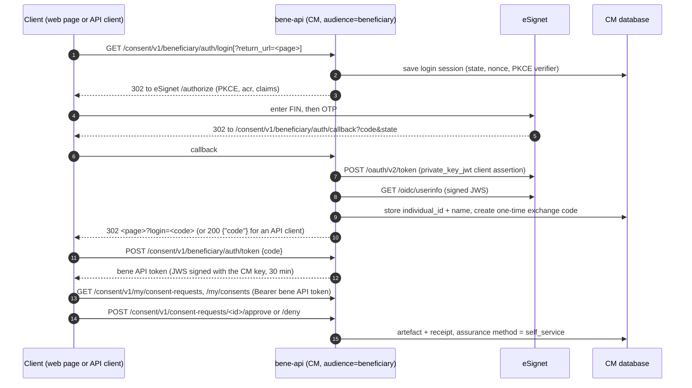

# Beneficiary API auth with national ID (eSignet)

This guide is for DevOps. It explains the **beneficiary API auth**: how a farmer
(beneficiary) logs in to the CM **bene API** with their national ID through
eSignet, and how to turn it on in a deployed environment, next to the existing
staff API (Keycloak staff realm) and partner API (partner realm / PM keys).

> **Short version:** set `beneApiAuth.enabled: true` in the
> `openg2p-consent-manager` chart (Rancher form: **Beneficiary API auth →
> Beneficiary API Auth with National ID (eSignet)**), with eSignet in the
> namespace. The chart does the rest. It is **off by default**: with the flag
> off, the chart renders exactly as before, so staff and partners see no change.

> **Not the same as consent login.** This is the bene API's own login: it says
> *who the farmer is* and is not tied to any consent request. The **consent
> login** (log in for ONE consent request, from its link) is a separate flow
> with its own endpoints, token and flag (`consentLogin.enabled`): see
> [section 7](#7-consent-login-separate-flow).

---

## 1. What the flow does

OpenG2P ships the bene API (`apiAudience: beneficiary`, `/consent/v1/my/*` and
`/consent/v1/consent-requests/*`) as a scaffold: disabled in the chart, expecting
a Keycloak "beneficiary realm" token, with no login of its own.

With this change the bene API has its **own login with the Fayda national ID
through eSignet** (the same eSignet and client the partner portal uses for its
national-ID step). The farmer gets a bene API token, and with it can:

- list their consent requests (`GET /consent/v1/my/consent-requests`),
- open a request and **grant** or **decline** it,
- list their consents, open one and **withdraw** it.

Two kinds of clients use the same login:

| Client | Login call | Callback answer |
|---|---|---|
| Web page (e.g. the console farmer pages `/my/consents`, `/consent/<id>`) | `GET …/beneficiary/auth/login?return_url=<page>` | `302` back to `<page>?login=<one-time code>` |
| API client (Postman, a mobile app backend, tests) | `GET …/beneficiary/auth/login` (no `return_url`) | `200 {"code": "<one-time code>", "expires_in": 120}` |

Either way the one-time code is swapped once at `POST …/beneficiary/auth/token`
for the bene API token.

### Bene API endpoints

| Endpoint | Who |
|---|---|
| `GET /consent/v1/beneficiary/auth/config`, `/login`, `/callback`, `POST /token` | anyone (the login itself) |
| `GET /consent/v1/beneficiary/auth/me` | bene API token |
| `GET /consent/v1/my/consent-requests`, `/my/consents`, `/my/consents/{id}`, `/my/receipts/{id}`; `POST /my/consents/{id}/revoke` | bene API token only |
| `GET /consent/v1/consent-requests/{id}`; `POST …/{id}/approve`, `…/{id}/deny`, `…/{id}/authenticate`; `POST /consent/v1/consents/{id}/revoke` | bene API token only |
| `POST /consent/v1/consent-requests` (raise a request) | a service (Keycloak token); a farmer gets 403 |

### Sequence



### Rules the API enforces

| Rule | Result |
|---|---|
| On the bene API with this on, the farmer's routes take **only** the bene API token. | A Keycloak token (staff, beneficiary realm) gets **403** `beneficiary API login (national ID) required`; no token **401**. |
| The farmer sees only requests and consents whose subject ID matches their national ID (`individual_id`), across all `SUBJECT_AUTH_ID_TYPES`. | Someone else's request returns **404**. |
| The farmer may answer only self-service requests (method empty or `self_service`). | Assisted or OTP requests return **409**. Those stay with staff or the partner portal. |
| The farmer cannot create requests or use staff routes. | **403** (staff API: 401) |
| `state` and the one-time code work once; the code lasts 2 minutes. `return_url` must be one of `allowedReturnUrls`. | **400** |
| The bene API token is signed by the CM signing key (`typ: bene+jwt`, issuer and audience `openg2p-consent-manager/beneficiary`), valid 30 minutes. | When it expires, the client logs in again. |
| A consent granted by the farmer gets the assurance `method: self_service`, with the bene API login recorded as the auth context. | This is visible in the receipt and the audit trail. |

---

## 2. What is in the code and the images

- **Backend:**
  - auth: `bene_auth_controller.py`, `bene_auth_service.py`, `models/bene_login.py`
    (table `bene_login_sessions`, created automatically by the normal migrate step on start);
  - the farmer's consents on the bene API: `bene_consent_service.py` (own requests, self-service rule,
    login recorded on approval), used by `subject_controller.py` and `lifecycle_controller.py`;
  - `auth.py`: bene API token check, `check_bene_login` (only the bene API token on the farmer routes).
- **Reuse:** it reuses OpenG2P's `SubjectAuthService`, the same eSignet client code as the partner portal.
- **eSignet 1.8 userinfo fix:** userinfo has no `exp`, and its `iss` is `<issuer>/v1/esignet`. This is handled in `SubjectAuthService`.
  - This also fixes the partner portal national-ID step, which failed before without a local patch.
- **UI (one web client of the bene API):** farmer mode is on when `config.json` has `beneficiaryAuth.enabled: true` and the path is `/consent/*` or `/my*`.
  - Farmer mode does not use Keycloak. All other console pages keep using Keycloak as before.
- **Tests:** 221 backend tests pass (`backend/tests/test_bene_api_auth.py`, consent login: `test_consent_login.py`).

---

## 3. Turning it on

### 3.1 Prerequisites

- eSignet is reachable in the namespace. It is the same one used by `partnerPortal.subjectAuth`.
  - For testing, the mock identity system must be there too.
- The CM signing key Secret (`consent-manager-signing`, `.p12`) exists. It already does for the staff and partner APIs.
- The partner portal does **not** have to be enabled. The bene API auth works with or without it.

### 3.2 Values

The only value you must set:

```yaml
beneApiAuth:
  enabled: true
```

Optional values (the defaults are fine):

```yaml
beneApiAuth:
  # eSignet sends the browser back here (console host).
  redirectUri: 'https://{{ tpl .Values.ui.hostname $ }}/consent/v1/beneficiary/auth/callback'
  # Where the login may send the browser back to (prefixes; prevents open redirects).
  allowedReturnUrls:
    - 'https://{{ tpl .Values.ui.hostname $ }}/'
  tokenTtlSeconds: 1800      # farmer token lifetime
  exchangeTtlSeconds: 120    # one-time ?login= code lifetime
  subjectIdType: FAYDA_FAN   # ID type in the farmer token
```

The eSignet client settings are **shared** with the partner portal and stay under
`partnerPortal.subjectAuth`:

- `esignetHostname`, `discoveryUrl`, `clientId`, `acrValues`, `idTypes`
- `keySecretName`, `bootstrap.*`

You do not need to set `partnerPortal.subjectAuth.enabled` for the bene API auth.

### 3.3 What the chart does when the flag is on

| # | Resource | Change |
|---|---|---|
| a | `extraApis` bene-api (Deployment, Service, HPA, VirtualService) | Deployed, even though its entry says `enabled: false`. `signingKeyMounted` is forced to `true`: farmer tokens are signed with the CM key, so every replica needs the same `.p12`. |
| b | bene-api env | `SUBJECT_AUTH_*`: the eSignet client (discovery, client id, acr, id types, key path). `BENE_AUTH_*`: enabled, redirect URI, allowed return URLs, TTLs, subject ID type. |
| c | bene-api volumes | The eSignet client key Secret `<release>-subject-auth-client-key` is mounted at `/subject-auth`. It is optional: the bootstrap Job may create it after the pod starts. |
| d | eSignet bootstrap Job | Runs for the bene API auth too, not only for the partner portal. It registers **all** needed redirect URIs: the partner portal callback (when that is on) and the bene API auth callback. |
| e | Console VirtualService (`<release>-console`) | A first route sends `/consent/v1/my/`, `/consent/v1/beneficiary/`, `/consent/v1/consent-requests` (and with `consentLogin`, `/consent/v1/consent-login/`) to `<release>-bene-api`. Everything else under `/consent/v1/` goes to the staff API, and the rest (including the page `/consent/<request id>`) to the UI. |
| f | UI ConfigMap | `config.json` gets `"beneficiaryAuth": { "enabled": true }`. `/my/consents` and `/consent/<id>` then use the national-ID login, and the staff "My Consents" menu item is hidden. |

The partner portal is not affected. It uses `/consent/v1/partner-portal/...` on its
own host. The staff API keeps its own eSignet settings (partner portal callback).

Notes:

- **Upgrade from an existing install with the partner portal on:** the bootstrap
  Job now passes `REDIRECT_URIS` (a JSON list) instead of `REDIRECT_URI`. With
  only the partner portal on, the list holds the same single URI as before.
- The Job **overwrites** `redirect_uris` on every `helm upgrade`. Do not add
  redirect URIs by hand in the eSignet database. Change the values instead.

### 3.4 Where another system owns eSignet

Set `partnerPortal.subjectAuth.bootstrap.enabled: false`. Then:

- the owner must register the client `partnerPortal.subjectAuth.clientId` with the
  farmer callback (and the partner portal callback, if used) as redirect URIs;
- you must provide the client's private key in the Secret
  `partnerPortal.subjectAuth.keySecretName` (key `client.pem`), with the public key
  registered in eSignet under `kid` = the client ID.

Example for a running test environment, if the Job cannot run. This is lost on the
next upgrade while the Job is enabled:

```sql
UPDATE esignet.client_detail
   SET redirect_uris = '["https://<partner portal host>/consent/v1/partner-portal/subject-auth/callback",
                         "https://<console host>/consent/v1/beneficiary/auth/callback"]',
       upd_dtimes = now()
 WHERE id = '<release>-consent-partner-portal';
```

### 3.5 OAN development: use the shared eSignet

OAN development already runs eSignet with the mock identity system at
<https://esignet.development.oanstaging.com>. Its discovery (checked on 26 Oct 2026)
offers everything this flow needs: `private_key_jwt` with RS256, the acr
`mosip:idp:acr:generated-code` and the claims `individual_id` and `name`. Use it
instead of deploying a second eSignet. This is the case of 3.4: the eSignet team owns
it, so the bootstrap Job stays off.

**1. Values**

```yaml
partnerPortal:
  subjectAuth:
    esignetHostname: esignet.development.oanstaging.com
    # discoveryUrl is built from esignetHostname; the JWKS comes from discovery
    # (https://esignet.development.oanstaging.com/.well-known/jwks.json).
    clientId: oan-consent-manager-dev    # the client ID the eSignet team registers
    bootstrap:
      enabled: false
beneApiAuth:
  enabled: true
consentLogin:
  enabled: true    # only if the consent login (section 7) is used
```

**2. The client key**

Create the RSA key pair once and keep the private key only in the cluster:

```sh
openssl genrsa -out client.pem 2048
kubectl -n <namespace> create secret generic <release>-subject-auth-client-key \
  --from-file=client.pem=client.pem
```

Convert the public key to a JWK with `kid` = the client ID, for example with
`python -c "from jwcrypto import jwk; k=jwk.JWK.from_pem(open('client.pem','rb').read()); print(k.export_public())"`,
then add `"kid"`, `"use": "sig"` and `"alg": "RS256"`. Send only the public JWK.
Never send `client.pem`.

**3. What to send to the eSignet team**

| Item | Value |
|---|---|
| Client ID | the `clientId` above |
| Public key | the public JWK from step 2 (`kid` = client ID) |
| Auth method | `private_key_jwt` |
| Redirect URIs | `https://<console host>/consent/v1/beneficiary/auth/callback`, plus `https://<console host>/consent/v1/consent-login/callback` (consent login) and `https://<partner portal host>/consent/v1/partner-portal/subject-auth/callback` (partner portal), when used |
| Claims | `name`, `individual_id` |
| ACR | `mosip:idp:acr:generated-code` |
| Grant / response type | `authorization_code` / `code` |

Ask them for a few test national IDs from the mock identity system and how the OTP
works there (the mock usually accepts a fixed OTP).

**4. Then** check it with section 4. Until the client is registered, eSignet answers
`invalid_client`. A missing redirect URI shows "invalid redirect_uri".

**Local run (docker-compose).** The compose files set the endpoints one by one, so
point all of them at the shared eSignet. The JWKS path is different from the local
eSignet's:

```
CONSENT_MANAGER_SUBJECT_AUTH_ISSUER=https://esignet.development.oanstaging.com
CONSENT_MANAGER_SUBJECT_AUTH_AUTHORIZE_URL=https://esignet.development.oanstaging.com/authorize
CONSENT_MANAGER_SUBJECT_AUTH_TOKEN_URL=https://esignet.development.oanstaging.com/v1/esignet/oauth/v2/token
CONSENT_MANAGER_SUBJECT_AUTH_USERINFO_URL=https://esignet.development.oanstaging.com/v1/esignet/oidc/userinfo
CONSENT_MANAGER_SUBJECT_AUTH_JWKS_URL=https://esignet.development.oanstaging.com/.well-known/jwks.json
CONSENT_MANAGER_SUBJECT_AUTH_CLIENT_ID=<the registered client ID>
CONSENT_MANAGER_SUBJECT_AUTH_KEY_KID=<the registered client ID>
```

The local `KEY_KID` (`consent-partner-portal-1`) only matches the local eSignet; set
it to the `kid` registered on the shared one (empty also means the client ID). Mount
that client's `client.pem` in place of `./esignet/keys/consent-partner-portal.pem`.
The `localhost` redirect URIs must then be registered on that client too.

---

## 4. Checking it after deploy

1. **Config endpoint:**
   `curl https://<console host>/consent/v1/beneficiary/auth/config`
   should return `{"enabled": true, "provider": "National ID (eSignet)"}`.
   A `404` means the bene route or the env is missing.
2. **Login redirect:**
   `curl -i "https://<console host>/consent/v1/beneficiary/auth/login?return_url=https://<console host>/my/consents"`
   should return `302` to `https://<esignet host>/authorize?...`.
3. **Bootstrap Job:** the log of `<release>-subject-auth-bootstrap-<revision>`
   should end with `eSignet client '...' registered (redirects [...])` and list the bene API auth callback.
4. **API client test (no UI, e.g. Postman):**
   1. `GET …/beneficiary/auth/login` without `return_url` (do not follow redirects) → `302` to eSignet.
   2. Log in at eSignet with a test FIN and OTP; eSignet redirects to `…/beneficiary/auth/callback?code&state`.
   3. Calling that callback returns `200 {"code": …}`; `POST …/beneficiary/auth/token {"code"}` returns the token.
   4. `GET …/my/consent-requests` with `Authorization: Bearer <token>` lists the farmer's requests;
      the same call with a staff (Keycloak) token returns `403`.

   The collection `postman/consent-manager-bene-api-esignet.postman_collection.json` runs
   all of this with assertions, plus the negative checks, when eSignet uses the mock
   identity system: see [`postman/README.md`](postman/README.md).
5. **Browser test:**
   1. Raise a **self-service** consent request for a test FIN, from a partner, the API or Postman.
   2. Open `https://<console host>/my/consents` and click "Log in with national ID".
   3. Enter the FIN and the OTP.
   4. You should come back to `/my/consents`, with the request under "Waiting for your answer".
   5. Click Review, then grant. The consent should show `active`.
6. **Staff check:** the staff console (Keycloak), the approvals page and the partner portal still work as before.

## 5. Troubleshooting

| Symptom | Likely cause |
|---|---|
| eSignet page shows "invalid redirect_uri" | The farmer callback is not registered. Check the bootstrap Job log (3.3 d), or the owner's registration (3.4). |
| Back on the console with `login_error=missing: ...` | A `SUBJECT_AUTH_*` value is missing on bene-api (3.3 b). |
| Callback page shows "invalid_client" | The key Secret is missing or not mounted (3.3 c), or a different key was registered. Check the `kid`. |
| Token works, then randomly returns 401 | The replicas have different `.p12` files, or the signing key is not mounted (3.3 a). |
| `/my/consents` calls return 404, or the staff API answers them | The console route is missing (3.3 e): check that `beneApiAuth.enabled` is true and that the `bene-api` route is first in `<release>-console`. |
| Login card never shows, the Keycloak login shows instead | `beneficiaryAuth` is missing in `config.json` (3.3 f). The UI pod may need a restart to pick up the ConfigMap. |
| Farmer sees no requests | The request's subject ID is not the FIN from eSignet, or its ID type is not in `partnerPortal.subjectAuth.idTypes`. Assisted and OTP requests are not shown on purpose. |
| Approve returns 409 | The request is assisted or OTP. Only self-service requests can be answered by the farmer. |

## 6. Production (real Fayda eSignet) notes

- **Client registration:** follow 3.4 (bootstrap Job off). Register one client with:
  - the redirect URIs,
  - the `private_key_jwt` auth method,
  - the claims `name` and `individual_id`,
  - the acr `mosip:idp:acr:generated-code`.
- **Userinfo signature:** confirm with Fayda which key signs userinfo. The code
  verifies userinfo with eSignet's JWKS from discovery.
- **SMS link:** sending the farmer an SMS with the link `https://<console host>/consent/<id>` is
  **not part of this change**. For now, the partner raises the request and the
  farmer logs in and finds it under `/my/consents`.

---

## 7. Consent login (separate flow)

The **consent login** is for a farmer who opens one consent request from its link
(`https://<console host>/consent/<request id>`, e.g. sent by the partner). The farmer
logs in with the national ID **for that request only**, then grants or declines it.
It shares nothing with the bene API auth above except the eSignet client.

| | Bene API auth (sections 1–6) | Consent login |
|---|---|---|
| Flag | `beneApiAuth.enabled` | `consentLogin.enabled` |
| Endpoints | `/consent/v1/beneficiary/auth/config\|login\|callback\|token\|me` | `/consent/v1/consent-login/config\|start\|callback\|token` |
| Start | `GET …/login[?return_url=]` | `GET …/start?request_id=<id>[&return_url=]` |
| eSignet redirect URI | `…/consent/v1/beneficiary/auth/callback` | `…/consent/v1/consent-login/callback` |
| Sessions table | `bene_login_sessions` | `consent_login_sessions` |
| Env | `CONSENT_MANAGER_BENE_AUTH_*` | `CONSENT_MANAGER_CONSENT_LOGIN_*` |
| Token | `typ: bene+jwt`, 30 min | `typ: consent-login+jwt`, claim `crid` = request id, 10 min |
| What the token may do | the farmer's requests and consents (`/my/*`, approve, deny, revoke) | **only** read, grant or decline its own request |
| UI | `/my/consents` (and requests opened from there) | `/consent/<id>` opened from its link (`config.json` `consentLogin`) |
| Recorded on the consent | `assurance.subject_authentication.login: bene_api` | `assurance.subject_authentication.login: consent_login` |

### Rules

| Rule | Result |
|---|---|
| A login starts only for a pending self-service request. | Unknown **404**; assisted / OTP or already answered **409** (a page gets `?login_error=`). |
| The national ID that logs in must be the request's subject (across `SUBJECT_AUTH_ID_TYPES`). | Callback **400** `the national ID that logged in is not the request's subject`. |
| `state` and the one-time code work once; the code lasts 2 minutes; `return_url` must be one of `consentLogin.allowedReturnUrls`. | **400** |
| The token is for its request only. | Another request (even the same farmer's), `/my/*`, revoke, `/beneficiary/auth/me`, raising a request: **403**. Staff API: **401**. |
| On the bene API with `consentLogin` and/or `beneApiAuth` on, the request routes take only national-ID tokens. | Keycloak token **403**. |

### Turning it on

```yaml
consentLogin:
  enabled: true
  # defaults (console host):
  # redirectUri: 'https://<console host>/consent/v1/consent-login/callback'
  # allowedReturnUrls: ['https://<console host>/']
  # tokenTtlSeconds: 600
  # exchangeTtlSeconds: 120
  # subjectIdType: FAYDA_FAN
```

With the flag on, the chart: deploys the bene-api (as for `beneApiAuth`) with the CM
signing key and the eSignet client key; sets the `CONSENT_MANAGER_CONSENT_LOGIN_*` env;
adds the consent login callback to the eSignet bootstrap Job's redirect URIs; routes
`/consent/v1/consent-login/` on the console host to the bene-api; sets
`"consentLogin": { "enabled": true }` in the console `config.json`. It can be turned on
with or without `beneApiAuth`. If eSignet is owned by another system, add the consent
login callback to the client there (as in 3.4).

### Checking it

1. `curl https://<console host>/consent/v1/consent-login/config` → `{"enabled": true, ...}`.
2. Raise a self-service request for a test FIN; then
   `curl -i "https://<console host>/consent/v1/consent-login/start?request_id=<id>"` → `302` to eSignet
   with `redirect_uri=…/consent-login/callback`.
3. Browser: open `https://<console host>/consent/<id>`, click "Log in with national ID", enter the FIN
   and OTP; you come back to the same request; grant. The consent's assurance shows `login: consent_login`.
4. With the token from step 3, `GET …/consent/v1/my/consents` returns `403`.
5. The collection `postman/consent-manager-consent-login-esignet.postman_collection.json`
   runs the whole flow as an API client, with assertions (mock identity system): see
   [`postman/README.md`](postman/README.md).
