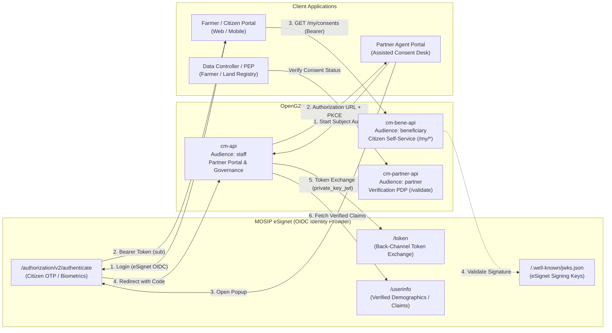
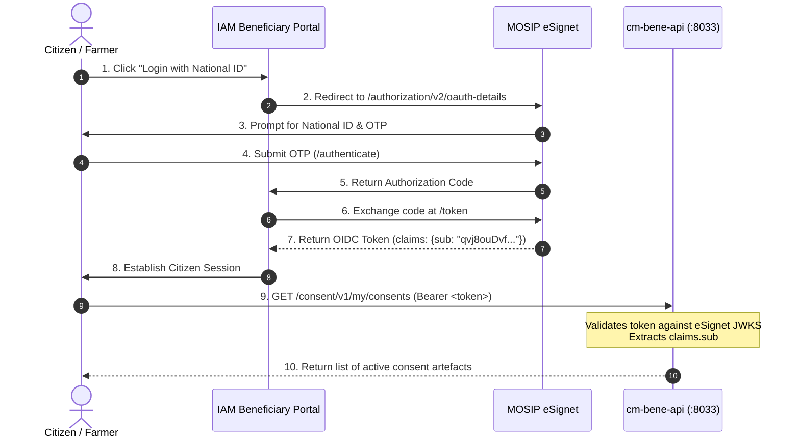
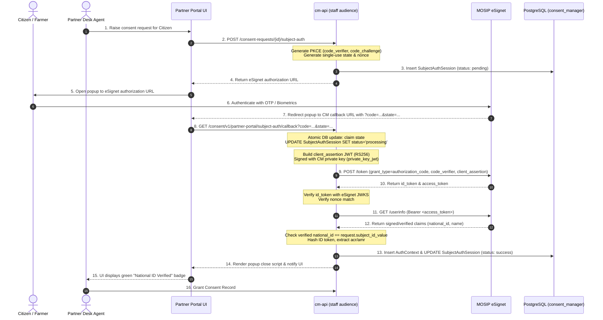
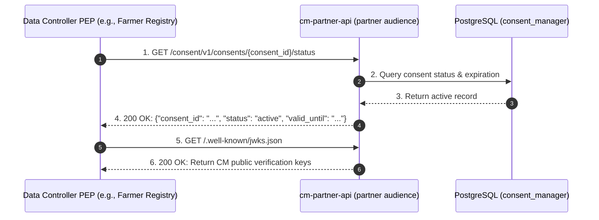

# eSignet & Consent Management Communication Architecture

This specification documents the communication protocols, cryptographic trust domains, token exchanges, and audience role segregation between **MOSIP eSignet** (the National ID OIDC Identity Provider) and **OpenG2P Consent Manager**.

---

## 1. Architectural Overview & Integration Models

The integration between eSignet and Consent Manager serves two distinct functional requirements:

1. **Citizen / Beneficiary Self-Service (`/consent/v1/my/*`)**:
   Citizens log in via eSignet OIDC on citizen portals (e.g., IAM Beneficiary Portal or mobile apps). Consent Manager validates the citizen's eSignet bearer token and serves granted consents and revocation controls.
2. **Assisted In-Person National ID Authentication (`/consent/v1/partner-portal/*`)**:
   When an assisted partner agent initiates a consent request in person, the citizen authenticates their identity via an eSignet popup (using OTP or biometrics). Consent Manager performs a secure back-channel token exchange (`private_key_jwt` + PKCE) directly with eSignet, validates the citizen's national ID against the consent request, and attaches a cryptographic `AuthContext` before granting consent.



---

## 2. The Three API Audiences & Trust Domains

Consent Manager partitions its API endpoints across three logical audiences. Each audience isolates distinct trust boundaries, authentication mechanisms, and network visibility:

| API Audience (`CONSENT_MANAGER_API_AUDIENCE`) | Service Role | Authentication Source & Trust Domain | Exposed Routes | Communication Target |
| :--- | :--- | :--- | :--- | :--- |
| **`staff`** | Back-office governance & Assisted Partner Portal | **Keycloak Staff & Partner Realms**<br>Bearer JWT signed by Keycloak JWKS | `/consent/v1/meta`<br>`/consent/v1/partners`<br>`/consent/v1/decisions`<br>`/consent/v1/partner-portal/*` | Staff administrators, compliance officers, and partner field agents |
| **`beneficiary`** | Citizen self-service portal | **MOSIP eSignet OIDC**<br>Bearer JWT signed by eSignet JWKS (`sub` = citizen PPID) | `/consent/v1/my/consents`<br>`/consent/v1/my/consents/{id}`<br>`/consent/v1/my/consents/{id}/revoke` | Citizens / farmers managing their own data consents |
| **`partner`** | High-throughput Policy Decision Point (PDP) | **Cryptographic JWS (No Keycloak)**<br>Partner Management public keys & transport mTLS | `/consent/v1/validate`<br>`/consent/v1/consents/{id}/status`<br>`/consent/v1/receipts/*`<br>`/.well-known/jwks.json` | Data controllers & registries checking consent validity |

### Why Dedicated Audiences Are Required for eSignet

1. **JWKS Key Collision**: `cm-bene-api` validates JWT signatures against eSignet's JWKS (`http://esignet.openg2p.localtest.me/.well-known/jwks.json`), whereas `cm-api` validates against Keycloak's JWKS. Combining them under a single audience causes token verification failures or forces bypassing signature checks.
2. **Decoupled Identity Models**: Citizens do not have accounts in the staff Keycloak realm; staff administrators do not have accounts in eSignet. Segregating audiences preserves identity domain boundaries.
3. **PEP/PDP Latency Isolation**: Data registries querying `cm-partner-api` (`/validate`, `/status`) execute high-volume, synchronous machine-to-machine calls. Decoupling PDP verification from citizen eSignet traffic guarantees high performance and zero dependency on external IdP availability.

---

## 3. Subject Identification: National ID vs eSignet Pairwise `sub`

A fundamental principle of eSignet is **Privacy by Design**, preventing correlation of citizen activity across different relying parties:

```
[Citizen National ID: 8267411072] 
                 │
                 ▼  (eSignet HMAC Salt: secret, one-way, per-relying-party)
[Pairwise Pseudonymous sub: qvj8ouDvf-EMtNwGAqyWHcFl-yGWk-nC8bQg4k8BmJ4]
```

### Key Identifier Principles
- **No Raw ID in `sub`**: eSignet never returns the raw National ID in the standard OIDC `sub` claim. It derives a **Pairwise Pseudonymous Identifier (PPID)** unique to the client application using a one-way HMAC salt.
- **Cross-Service Resolution**: When a partner creates a consent request, the target citizen can be identified by:
  - The pairwise pseudonymous `sub` (e.g. `qvj8ouDvf-...`), or
  - An application-level verified identifier (such as national ID), which is resolved during eSignet authentication.
- **Consent Artefact Storage**: In `consent_artefacts`, the record stores `subject_id_value = <pairwise_sub>`. When the citizen accesses `cm-bene-api` with their eSignet token, the backend queries:
  ```sql
  SELECT * FROM consent_artefacts 
  WHERE subject_id_value = :caller_sub 
    AND status = 'active';
  ```

---

## 4. Communication Architecture 1 — Citizen Self-Service (`cm-bene-api`)

This flow allows a citizen (e.g., a farmer) to view and manage their granted data consents.



### Token Validation on `cm-bene-api`
When `cm-bene-api` receives the request:
1. It validates the `Authorization: Bearer <token>` against `CONSENT_MANAGER_AUTH_JWKS_URL` (`http://esignet.openg2p.localtest.me/.well-known/jwks.json`).
2. It verifies that `iss` equals `CONSENT_MANAGER_AUTH_ISSUER` (`https://esignet.openg2p.localtest.me`).
3. It extracts `claims["sub"]` and filters consent artefacts directly in PostgreSQL:
   ```python
   # backend/src/openg2p_consent_manager/controllers/subject_controller.py
   @router.get("/consent/v1/my/consents")
   async def list_my_consents(user: SubjectUser = Depends(current_subject_user)):
       return await service.get_consents_for_subject(user.subject_id)
   ```

---

## 5. Communication Architecture 2 — Assisted National ID Authentication

Implemented in [`backend/src/openg2p_consent_manager/services/subject_auth_service.py`](file:///Users/arnav/Code/openg2p-workspace/consent-management/backend/src/openg2p_consent_manager/services/subject_auth_service.py), this flow allows a partner agent at a service desk to obtain verified national ID consent from a citizen present in person.

### Detailed Protocol Flow



### Technical Security Controls in `subject_auth_service.py`

1. **Anti-Replay Single-Use State Claim**:
   ```python
   # Atomic database update claims the state; concurrent or replayed callbacks fail immediately
   claimed = await session.execute(
       update(SubjectAuthSession)
       .where(
           SubjectAuthSession.state == state,
           SubjectAuthSession.status == SubjectAuthStatus.pending.value,
           SubjectAuthSession.expires_at > _now(),
       )
       .values(status=SubjectAuthStatus.processing.value)
       .returning(SubjectAuthSession.id)
   )
   ```
2. **Back-Channel Client Assertion (`private_key_jwt`)**:
   Instead of using static shared secrets, Consent Manager signs a client assertion JWT using its private RSA key loaded from `CONSENT_MANAGER_SUBJECT_AUTH_PRIVATE_KEY_PATH`:
   ```python
   assertion = jwt.encode(
       {"iss": client_id, "sub": client_id, "aud": meta["token_endpoint"], 
        "jti": str(uuid.uuid4()), "iat": now, "exp": now + 300},
       self.private_key(), algorithm="RS256",
       headers={"kid": _config.subject_auth_key_kid or client_id},
   )
   ```
3. **Subject Claim Verification**:
   The backend inspects the verified claims from eSignet and asserts that the authenticated national ID precisely matches the consent request's `subject_id_value`:
   ```python
   if _norm(subject) != _norm(req.subject_id_value):
       raise LifecycleError(403, "the authenticated person is not the request's subject")
   ```
4. **Token Minimization & Evidence Anchoring**:
   Consent Manager never stores raw ID or access tokens in the database. It stores only:
   - `id_token_hash`: SHA-256 fingerprint of the ID token.
   - `acr` / `amr`: Authentication context and method (e.g. `pwd,otp` or `bio`).
   - `auth_timestamp`: Verified timestamp issued by eSignet.

---

## 6. Communication Architecture 3 — Policy Decision Point (PDP Verification)

Once consent is granted via eSignet authentication, data controllers (e.g. Land Registry, Farmer Registry) call `cm-partner-api` (`API_AUDIENCE=partner`) to verify whether consent is active before releasing citizen data:



- **Zero IdP Dependencies**: `cm-partner-api` performs no calls to Keycloak or eSignet.
- **Sub-Millisecond Verification**: Fast database lookups and cached cryptographic key validation ensure real-time policy evaluation.

---

## 7. Configuration Reference

### Beneficiary Audience (`cm-bene-api`)
```ini
CONSENT_MANAGER_API_AUDIENCE=beneficiary
CONSENT_MANAGER_AUTH_ENABLED=true
CONSENT_MANAGER_AUTH_ISSUER=https://esignet.openg2p.localtest.me
CONSENT_MANAGER_AUTH_JWKS_URL=http://esignet.openg2p.localtest.me/.well-known/jwks.json
CONSENT_MANAGER_SUBJECT_DEFAULT_ID_TYPE=national_id
```

### Assisted Subject Authentication (`cm-api`, staff audience)
```ini
CONSENT_MANAGER_SUBJECT_AUTH_ENABLED=true
CONSENT_MANAGER_SUBJECT_AUTH_PROVIDER_NAME=eSignet
CONSENT_MANAGER_SUBJECT_AUTH_DISCOVERY_URL=https://esignet.openg2p.localtest.me/.well-known/openid-configuration
CONSENT_MANAGER_SUBJECT_AUTH_CLIENT_ID=openg2p-consent-manager
CONSENT_MANAGER_SUBJECT_AUTH_REDIRECT_URI=http://consent-manager.openg2p.localtest.me/consent/v1/partner-portal/subject-auth/callback
CONSENT_MANAGER_SUBJECT_AUTH_PRIVATE_KEY_PATH=/app/secrets/esignet-client.pem
CONSENT_MANAGER_SUBJECT_AUTH_SUBJECT_CLAIM=individual_id
CONSENT_MANAGER_SUBJECT_AUTH_ID_TYPES=["national_id"]
```

---

## 8. Summary of Audience Responsibilities

```
┌───────────────────────────────────────────────────────────────────────────────────────┐
│                                 eSignet OIDC Provider                                 │
└───────────────────▲───────────────────────────────────────────────▲───────────────────┘
                    │                                               │
           OIDC Bearer Auth                                Back-Channel Exchange
             (JWKS + sub)                                  (PKCE + private_key_jwt)
                    │                                               │
┌───────────────────┴───────────────────────┐   ┌───────────────────┴───────────────────┐
│ cm-bene-api (API_AUDIENCE=beneficiary)    │   │ cm-api (API_AUDIENCE=staff)           │
│ • Citizen /my/consents                    │   │ • Staff governance & policy admin     │
│ • Citizen consent revocation              │   │ • Partner Portal (assisted consent)   │
│ • Directly resolves eSignet pairwise sub  │   │ • Handles eSignet popup callback      │
└───────────────────────────────────────────┘   └───────────────────────────────────────┘
                                                
┌───────────────────────────────────────────┐
│ cm-partner-api (API_AUDIENCE=partner)     │
│ • High-throughput Verification PDP        │
│ • Cryptographic JWS verification          │
│ • Independent of Keycloak and eSignet     │
└───────────────────────────────────────────┘
```
